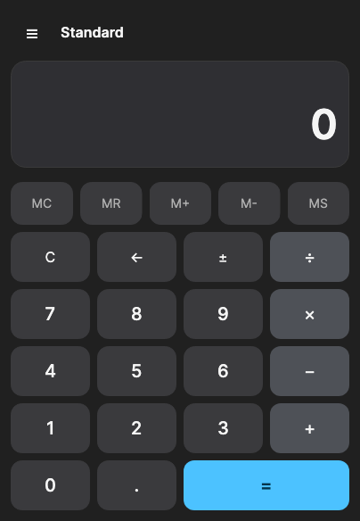

# Calcvik

A desktop calculator built with Avalonia and .NET 10. It supports standard calculations, scientific expressions, and integer operations in multiple number systems.



## Features

- **Standard mode:** arithmetic, percentages, square, square root, and reciprocal.
- **Scientific mode:** expressions with parentheses, powers, factorials, trigonometric functions, and logarithms.
- **Programmer mode:** DEC, HEX, OCT, BIN, bitwise operations, and shifts.
- Memory operations: `MC`, `MR`, `M+`, `M-`, and `MS`.
- Degree and radian angle modes.
- Light, dark, and system themes.
- Mouse and keyboard input.

The selected theme is stored in the platform's application data directory under `Calcvik`.

## Requirements

- [.NET 10 SDK](https://dotnet.microsoft.com/download/dotnet/10.0)

NuGet restores all other dependencies automatically.

## Run

```sh
git clone git@github.com:svncore/calcvik.git
cd calcvik
dotnet run --project src/Calcvik.csproj
```

## Build and test

```sh
dotnet build Calcvik.slnx
dotnet test Calcvik.slnx
```

GitHub Actions tests the project on Linux, Windows, and macOS. Pushes to `main` publish a GitHub Release with portable archives, a Windows MSI, Linux AppImage and Debian packages, and DMGs for Intel and Apple Silicon Macs.

## Keyboard controls

| Key | Action |
|---|---|
| `0`–`9` | Enter digits |
| `+`, `-`, `*`, `/` | Arithmetic operations |
| `Enter` | Calculate the result |
| `Escape` | Clear |
| `Backspace` | Delete the last character |
| `F9` or `N` | Change the sign |
| `.` | Enter a decimal separator |

## Author

Created and maintained by [svncore](https://github.com/svncore).

## License

This project is available under the [MIT License](LICENSE).
